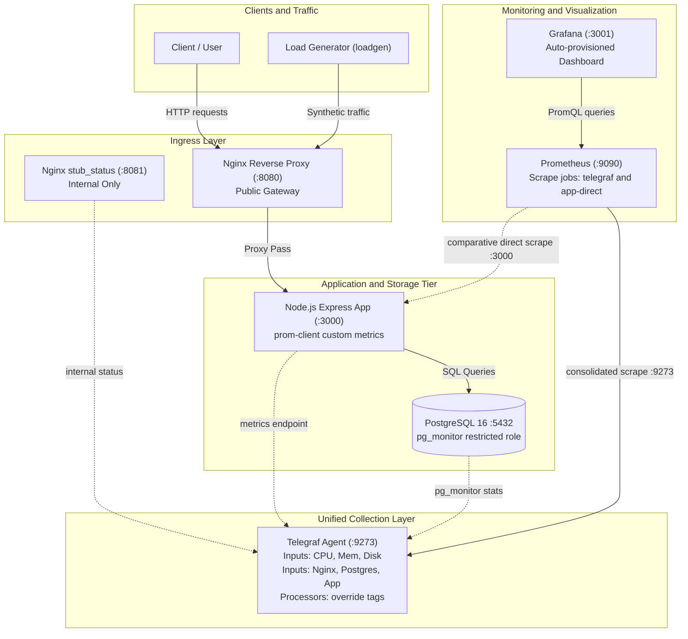

<div align="center">

# 🔭 Telegraf Observability Lab

**Unified Multi-Source Metrics Collection & SRE Golden Signals Playground**

[](https://github.com/Alexandre-Ginesy/telegraf-lab/actions/workflows/ci.yml)
[](https://docs.docker.com/compose/)
[](https://www.influxdata.com/time-series-platform/telegraf/)
[](https://prometheus.io/)
[](https://grafana.com/)
[](https://www.postgresql.org/)
[](https://nginx.org/)

[Architecture](#-architecture) • [Why Telegraf?](#-why-telegraf-as-a-unified-collector) • [Quick Start](#-quick-start) • [Golden Signals & SRE Scenarios](#-sre-golden-signals--incident-scenarios) • [Components](#-components-breakdown)

</div>

---

## 📌 Overview

This lab demonstrates how to use **Telegraf** as a **single, unified telemetry collector** to replace multiple disparate Prometheus exporters across an infrastructure.

Instead of running and maintaining separate daemons (`node_exporter`, `nginx-prometheus-exporter`, `postgres_exporter`), a single lightweight Telegraf agent gathers metrics from the host, the web server, the database, and application endpoints, enriches them on the fly, and re-exposes a consolidated `/metrics` endpoint scraped by Prometheus.

Additionally, a parallel scraping job (`app-direct`) is maintained so both ingestion paths (direct scraping vs. collector aggregation) can be compared in real time.

---

## 🏗 Architecture

```text
+-----------------------------------------------------------------------------------------+
|                                  ARCHITECTURE FLOW                                      |
|                                                                                         |
|   [Clients / Users]         [loadgen (traffic generator)]                               |
|           │                              │                                              |
|           └──────────────┬───────────────┘                                              |
|                          ▼ HTTP                                                         |
|         ┌─────────────────────────────────┐                                             |
|         │    Nginx Reverse Proxy (:8080)  │ (Public Gateway)                            |
|         └────────────────┬────────────────┘                                             |
|                          ▼ HTTP Proxy                                                   |
|         ┌─────────────────────────────────┐       SQL Queries     ┌──────────────────┐  |
|         │   Node.js Express App (:3000)   │ ────────────────────► │ PostgreSQL 16    │  |
|         │   (/items, /slow, /flaky)       │                       │ (:5432)          │  |
|         └────────────────┬────────────────┘                       └────────┬─────────┘  |
|                          │                                                 │            |
|       Nginx status       │ Scrape /metrics                                 │ pg_monitor |
|       (:8081 internal)   │ (prom-client)                                   │ queries    |
|              │           │                                                 │            |
|              ▼           ▼                                                 ▼            |
|   ===================================================================================   |
|   │                           TELEGRAF AGENT (Unified)                              │   |
|   │   • inputs.cpu / mem / disk             • inputs.nginx                          │   |
|   │   • inputs.postgresql                   • inputs.prometheus                     │   |
|   │   • processors.override (tags)          • outputs.prometheus_client (:9273)     │   |
|   ===========================================┬=======================================   |
|                                              │                                          |
|                                              ▼ Consolidated Scrape (:9273)              |
|                                   ┌──────────────────────┐                              |
|   App Direct Scrape (:3000) · · · │  Prometheus (:9090)  │                              |
|   (comparative reference job)     └──────────┬───────────┘                              |
|                                              │ PromQL Queries                           |
|                                              ▼                                          |
|                                   ┌──────────────────────┐                              |
|                                   │   Grafana (:3001)    │ (Pre-provisioned Dashboard)  |
|                                   └──────────────────────┘                              |
+-----------------------------------------------------------------------------------------+
```

<details open>
<summary><b>Afficher le diagramme dynamique Mermaid</b></summary>


</details>

---

## ⚖ Why Telegraf as a Unified Collector?

In modern cloud-native architectures, managing distinct exporters for every component introduces operational friction (exporter sprawl, disparate network ports, lack of tag consistency).

| Evaluation Criteria | Traditional Multi-Exporter Approach | Unified Telegraf Collector (This Lab) |
|---|---|---|
| **Daemon Overhead** | 4+ distinct background daemons | **1 unified lightweight agent** |
| **Attack Surface & Ports** | 4 open ports (`9100`, `9113`, `9187`, `3000`) | **1 internal endpoint** (`:9273`) |
| **In-Flight Data Enrichment** | Complex relabeling on Prometheus server | **Edge processors** (`processors.override`, `strings`) |
| **Privilege Isolation** | Varies by exporter | Standardized dedicated credentials (`pg_monitor`) |
| **Prometheus Configuration** | Heavy targets and scrape pool management | Single consolidated scrape target |
| **Protocol Flexibility** | Prometheus pull only | Can dual-write to Prometheus, InfluxDB, Kafka, OpenTelemetry |

---

## 🚀 Quick Start

### Prerequisites
- **Docker** and **Docker Compose v2** (e.g. Docker Desktop on macOS/Windows, or Docker Engine on Linux).
- Optional: `make` (Linux/macOS) or PowerShell (Windows).

### 1. Launch the Stack

Using **Make**:
```bash
make up       # Copies .env.example if missing, builds and starts the lab
make load     # Starts continuous synthetic traffic generation in background
```

Using **Docker Compose** directly (Universal):
```bash
# 1. Initialize environment variables
cp .env.example .env     # On Windows PowerShell: Copy-Item .env.example .env

# 2. Build and start the services
docker compose up -d --build

# 3. Start the synthetic load generator
docker compose --profile load up -d loadgen
```

### 2. Access the Endpoints

| Service | URL | Notes |
|---|---|---|
| **Web Gateway (Nginx)** | [http://localhost:8080](http://localhost:8080) | Serves `/items`, `/slow`, `/flaky` |
| **Grafana Dashboard** | [http://localhost:3001](http://localhost:3001) | User: `admin` / Password: `change-me-grafana` |
| **Prometheus UI** | [http://localhost:9090](http://localhost:9090) | Targets: [http://localhost:9090/targets](http://localhost:9090/targets) |
| **Telegraf Exporter** | [http://localhost:9273/metrics](http://localhost:9273/metrics) | Consolidated Prometheus endpoint |

---

## 🎯 SRE Golden Signals & Incident Scenarios

The auto-provisioned Grafana dashboard (**Telegraf Lab - Overview**) maps directly to Google's **4 Golden Signals**:

```
+-----------------------------------------------------------------------------------+
|                            4 GOLDEN SIGNALS MONITORING                            |
+--------------------------+--------------------------------------------------------+
| 1. Latency               | App HTTP duration (p95 quantile), PostgreSQL queries   |
| 2. Traffic               | Nginx requests/s, App requests/s                       |
| 3. Errors                | App HTTP 5xx responses breakdown (/flaky)              |
| 4. Saturation            | PostgreSQL active connections, Host CPU & Memory %     |
+--------------------------+--------------------------------------------------------+
```

### Guided Experimentation

#### Scenario 1: Latency Spike & Queue Saturation
Simulate a slow synchronous operation and watch the p95 latency diverge:
```bash
# Send parallel requests to the artificial delay route
for i in {1..5}; do curl -s http://localhost:8080/slow & done
```
*Observe in Grafana:* The **App - latency p95** panel immediately spikes up to 1-2s while the database query durations remain unaffected, pinpointing an application-tier bottleneck.

#### Scenario 2: Error Rate Anomaly Detection
Trigger transient internal server errors:
```bash
curl -s http://localhost:8080/flaky
```
*Observe in Grafana:* The **App - requests/s by status** panel displays an increase in `status="500"` series, showing immediate error budget burn.

#### Scenario 3: Database Load & Transaction Volume
Execute bulk database insertions:
```bash
curl -s -X POST -H "Content-Type: application/json" -d '{"name":"perf-test"}' http://localhost:8080/items
```
*Observe in Grafana:* Spikes in **PostgreSQL - commits/s** and connection backends.

---

## 🧩 Components Breakdown

```
telegraf-lab/
├── app/                      # Node.js Express service
│   ├── Dockerfile            # Multi-stage lightweight build
│   ├── server.js             # HTTP API + prom-client instrumentation
│   └── package.json
├── db/
│   └── init.sh               # PostgreSQL init script: creates restricted telegraf role
├── nginx/
│   └── default.conf          # Reverse proxy (80) & secure internal status (8081)
├── telegraf/
│   └── telegraf.conf         # Unified inputs, processor enrichment & prometheus output
├── prometheus/
│   └── prometheus.yml        # Scrape configs for telegraf and comparative app-direct
├── grafana/
│   ├── provisioning/         # Datasource & dashboard declarative provisioning
│   └── dashboards/
│       └── overview.json     # Pre-built SRE Golden Signals dashboard
├── .github/workflows/
│   └── ci.yml                # CI pipeline: static linting (promtool, telegraf) + e2e smoke tests
├── docker-compose.yml        # Multi-container orchestration & load profile
├── Makefile                  # Developer ergonomics (up, down, lint, load, test)
└── load.ps1                  # Native Windows PowerShell load generator
```

---

## 🛠 Useful Commands (`Makefile` & CLI)

| Target | Command | Description |
|---|---|---|
| `make up` | `docker compose up -d --build` | Starts all services in the background |
| `make down` | `docker compose down` | Stops running containers |
| `make ps` | `docker compose ps` | Displays health & port status of containers |
| `make logs` | `docker compose logs -f` | Tails logs across all services |
| `make load` | `docker compose --profile load up -d loadgen` | Runs containerized traffic generator |
| `make load-stop`| `docker compose stop loadgen` | Pauses synthetic load |
| `make lint` | `promtool` & `telegraf config check` | Statically validates configs against container tools |
| `make test` | Smoke test script | Verifies HTTP endpoints and Prometheus ingestion |
| `make clean`| `docker compose down -v` | Tears down stack and purges all persistent data volumes |

---

## 🔒 Security Best Practices Implemented

- **Principle of Least Privilege**: The `telegraf` user on PostgreSQL is granted only `pg_monitor`, strictly preventing database alterations.
- **Port Exposure Hardening**: Nginx's internal monitoring endpoint (`:8081/nginx_status`) is bound exclusively within the Docker network; only public port `8080` is published to the host.
- **Zero Hardcoded Secrets**: Sensitive variables (`POSTGRES_PASSWORD`, `GRAFANA_ADMIN_PASSWORD`) are decoupled into `.env` and kept out of version control.
- **Fail-Fast Automated Quality Gates**: Configurations are statically linted with official compiler tools (`promtool` and `telegraf config check`) in GitHub Actions before deployment.

---

